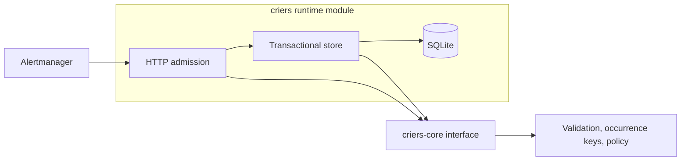

# 001: Pure core and a transactional runtime

Status: accepted.

## Decision

Use two Cargo crates with one-way dependencies. Share version, edition, license,
dependency versions, and lints in the workspace root.

The `criers-core` module owns protocol types, validation, canonical occurrence
keys, and deterministic policy. Its interface exports domain types directly.
It has no HTTP, database, async runtime, credentials, or remote dependencies.
Chrono clock access is enabled only by the runtime crate.

The `criers` module owns configuration, authentication, request admission,
SQLite, and runtime concurrency. Its store interface exposes ingestion,
snapshot, and readiness. SQL and blocking-worker admission remain private.
The implementation keeps observations, occurrence changes, decisions, and
shadow intents in one transaction, acknowledged only after commit.

## Depth and locality

The store is a deep module: a small interface hides lifecycle and transactional
failure behavior. Readiness SQL belongs there, not in the HTTP adapter. Fault
injection uses an internal test seam; assertions observe HTTP and store results.
This provides leverage without publishing arbitrary connection callbacks.

Keep the core seam concrete. No repository trait, model plugin trait, extra
lifecycle crate, or generic event framework is justified by the current scope.
Add an adapter seam only when real implementations require it.

## Consequences

- Core policy can be exercised independently without Tokio or SQLite.
- SQLite state and lifecycle changes remain local to one implementation.
- Workspace tests preserve restart deduplication, escalation, stale-event
  handling, authentication, admission, and transactional rollback behavior.
- The runtime is single-process and shadow-only. It is not an active-active
  deployment or a working remote notification sender.
